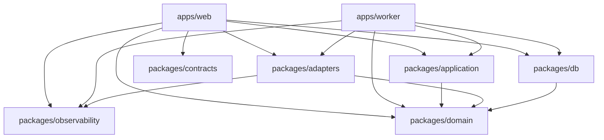
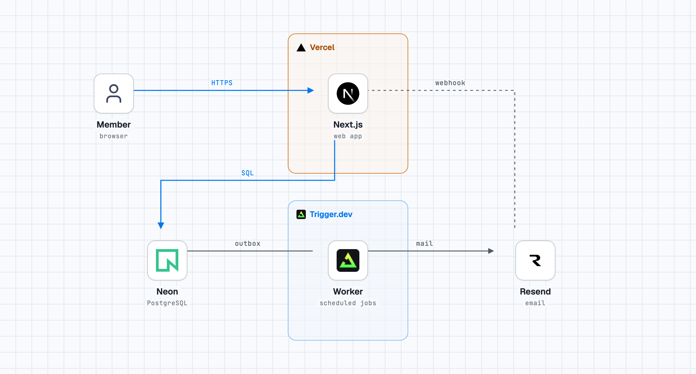
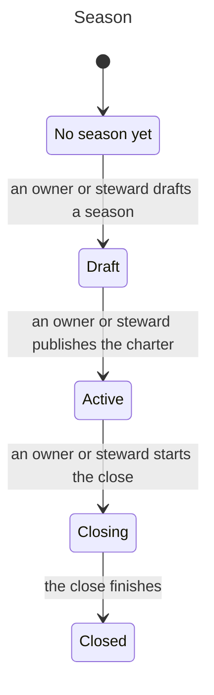
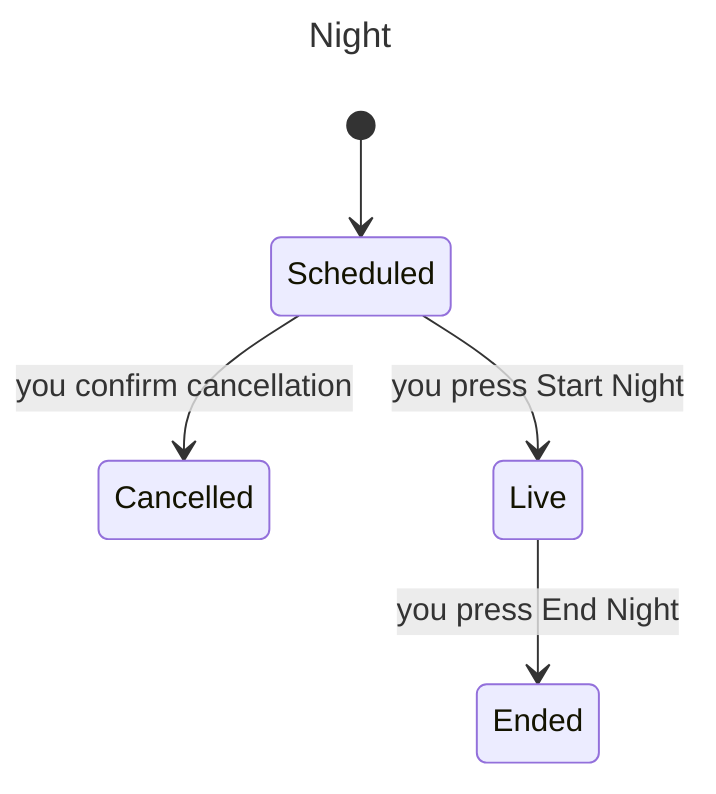
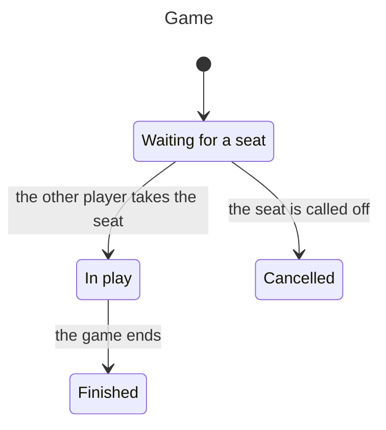
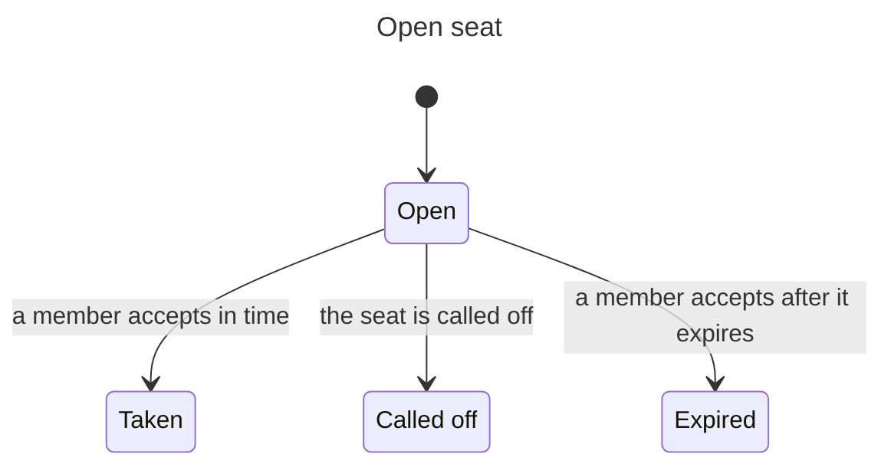
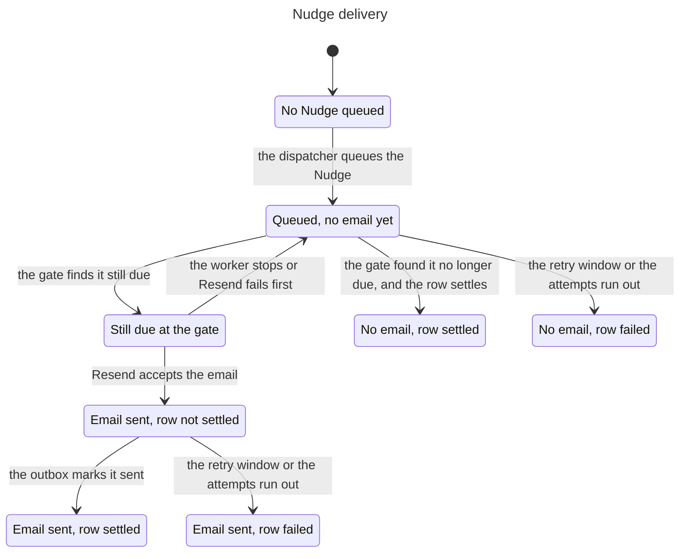

# Architecture

Between Moves is a pnpm workspace. `apps/web` serves the house in the browser. `apps/worker` runs the scheduled jobs. The packages under `packages/` hold the rules, the use cases, the database, and the outside services.

## How the packages depend on each other

An arrow means the package depends on the one it points at. The edges are the `@between-moves/*` entries in each `package.json`.

`packages/contracts` and `packages/domain` and `packages/observability` depend on no workspace package. `apps/web` is the only workspace package that declares a dependency on `contracts`.

`eslint.config.mjs` allows a wider set of imports than those edges. It lets `domain` import `contracts` as a type, and it names `@between-moves/config`, which is not a package. Web configuration is the module `apps/web/src/config/index.ts`.

The root boundary lint covers `apps/worker` and `packages/domain`, `packages/application`, `packages/db`, `packages/adapters`, and `packages/observability`. It does not cover `apps/web` or `packages/contracts`. Web lint is `apps/web/eslint.config.mjs`, which adds the Next.js rules and `react/no-danger`. Contracts has no ESLint config in this repo.

## Where it runs

A member uses the Next.js app on Vercel. That app and the Trigger.dev worker share one Neon database. The worker sends mail through Resend, and Resend posts delivery events back to the web app.

The dark picture is [architecture/stack-dark.png](architecture/stack-dark.png). The page behind both pictures is [architecture/stack.html](architecture/stack.html).

## Where a command runs

A page or route under `apps/web/src/app` calls a module in `apps/web/src/modules` or a handler in `apps/web/src/server`. That code is the composition root. It calls a use case from `packages/application`, a repository from `packages/db`, and an adapter from `packages/adapters`. Application code calls domain functions and does not import `db` or `adapters`.

The worker composition root is `apps/worker/src/composition.ts`. Trigger.dev schedules live in `apps/worker/src/trigger`. They dispatch the outbox, nudges, and analysis jobs.

Chess rules go through `packages/adapters/src/chess-js-rules-adapter.ts`. The domain talks to that adapter through the port in `packages/domain/src/games/rules-adapter.ts`.

## Season

One season moves through the states below. `SeasonState` in `packages/domain/src/seasons/index.ts` is `draft`, `active`, `closing`, or `closed`. `transitionSeasonState` allows only the four steps in the chart. A house has at most one `active` or `closing` season. The unique index `seasons_one_active_or_closing_per_house` is in `packages/db/migrations/0007_seasons/up.sql`, and `packages/db/src/pg-season-repository.ts` maps that constraint error.

`beginClosing` freezes standings and enqueues `season.closing` in one transaction. `finalize` marks the season `closed` in a later transaction. Closing book generation does not have to finish before that second transaction. The comment on `TRANSITIONS` in `packages/domain/src/seasons/index.ts` says so.

The chart hides the step that leaves a closed season closed. A following season is a new row, so `transitionSeasonState` has no arrow back to draft. The table stores only `draft`, `active`, `closing`, and `closed`. No season yet means the house has no season row. `transitionSeasonState` throws when the current state is `closed`. A direct SQL update can still move a closed row to `active` if it also clears `closed_at` and the house has no other active or closing season. The check constraint allows that pair of values.

## Night

`NightState` in `packages/domain/src/nights/night.ts` is `scheduled`, `live`, `ended`, or `cancelled`. Start and end go through `transitionNightLifecycle` in `packages/domain/src/nights/lifecycle.ts`. Cancel and reschedule go through `PgNightRepository.change` in `packages/db/src/pg-night-repository.ts`.

An owner, a steward, or the assigned host can press Start Night and End Night. `canHost` in `apps/web/src/app/h/[houseId]/season/night-schedule.tsx` is that rule, and `lockAuthorizedNight` in `packages/db/src/pg-night-lifecycle-repository.ts` matches it. Cancel Night is only for an owner or a steward, and only while the night is scheduled. The lifecycle queries also require the night's season to be `active` or `closing`.

Pressing Start Night on a live night, End Night on an ended night, or confirming cancellation on a cancelled night leaves the state as it is. The chart hides those repeats. Reschedule also stays on Scheduled, so the chart hides it.

## Game

The `games.state` check in `packages/db/migrations/0010_games_schema/up.sql` allows `waiting`, `active`, `completed`, and `cancelled`.

Accepting a correspondence seat before it expires sets the game to `active`. Accepting a live seat does the same only while that night is still `live`. Calling the seat off sets a `waiting` game to `cancelled`. Resign, an agreed draw, a flag on the clock, or a move the rules treat as over sets an `active` game to `completed`. Those writes are in `packages/db/src/pg-game-seat-acceptance-repository.ts`, `packages/db/src/pg-game-seat-cancellation-repository.ts`, `packages/db/src/pg-game-completion-repository.ts`, and `packages/db/src/pg-submit-move-repository.ts`. A new command on the wrong state is refused. Repeating a cancel on an already cancelled game leaves it cancelled. Repeating a completion or a move returns the earlier result.

The chart hides those repeats. A late accept does not follow either arrow out of Waiting for a seat. It expires the open seat and leaves the game `waiting`.

## Open seat

The `open_seats.state` check in the same migration allows `open`, `accepted`, `expired`, and `cancelled`. The seat chart is separate from the game chart because those names are not the game names.

The person who opened the seat, or the member a direct challenge names, can call it off while the seat is still `open`. Anyone else is denied. The creator cannot accept their own seat. A late accept sets the seat to `expired`, commits that update, and then reports the seat as not found. The game row stays `waiting`. A later cancel throws not found, because `packages/db/src/pg-game-seat-cancellation-repository.ts` refuses an expired seat. The house list in `packages/db/src/pg-open-seat-read-repository.ts` loads only seats that are still `open` and unexpired.

The chart hides the step that leaves a taken, expired, or called-off seat where it is.

## Nudge

A Nudge is an email that tells a player it is their move in a correspondence game. The `advance` stage goes out before `move_due_at`, and the `overdue` stage from `move_due_at` on. `createNudgeDispatcher` in `packages/application/src/delivery/nudges.ts` queues one `nudge.due` outbox event per game, ply, recipient and stage. The primary key of `nudge_deliveries` holds that key. The outbox delivers the event later, maybe after a retry.

One rule says whether a Nudge is still due: `dueNudgesAt` in `packages/db/src/due-nudges.ts`. `findDue`, `lockCurrentNudge` and `PgNudgeDeliveryGate.pass` all select from it. The Nudge sender accepts only a `VerifiedNudgeDelivery`, and only the gate issues one. The gate reads current state with the clock read for that attempt. It holds no lock while Resend runs, so a reply or a game end in that gap can still let one email out for the turn that just closed. A Nudge that is no longer due is skipped: its event settles with no email, and the metric counts `skipped`.

The TLA+ model `architecture/models/nudge-outbox/NudgeOutbox.tla` checks that rule across retries, lease loss, crashes and Resend timeouts. Run it with `pnpm formal:check`. [`.claude/skills/verify-nudge-outbox/SKILL.md`](.claude/skills/verify-nudge-outbox/SKILL.md) gives its bounds, how to read a failure, and how to update it.

The chart follows one Nudge through a one-worker, one-turn run of the model. It hides the steps that stay in one state, such as a claim, a tick, or a lease that runs out.

## Account

A signed-in person uses `/account`. Export is `GET /api/account/export`. Delete is `POST /api/account/delete` with the confirmation text `ACCOUNT_DELETION_CONFIRMATION` in `packages/contracts/src/account-data-rights.ts`, which is `delete my account`.

An owner of an active house gets HTTP 409 until they transfer the house. The integration test is `apps/web/src/server/account-data-rights.integration.test.ts`. The deleted person is shown as Former member. Games, moves, and messages stay.

## What to read in the code

Season scoring and the closing book live under `packages/domain/src/seasons` and `packages/application/src/seasons`. Nights live under `packages/domain/src/nights`. The analysis callback contract is in [ops/deploy.md](ops/deploy.md).
